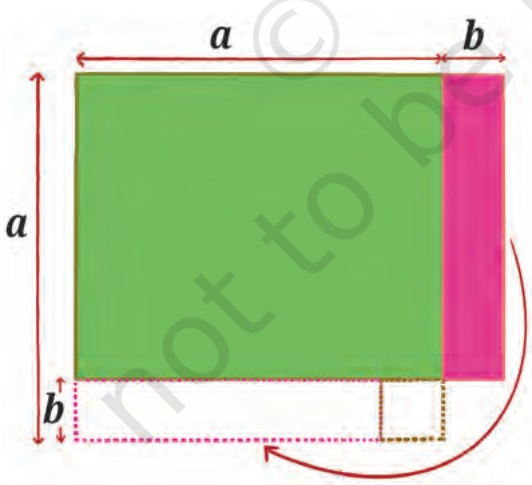

2. Factor using suitable identities:

(i) $1 6 y ^ { 2 } - 2 4 y + 9$

(ii)

$$
\frac { 9 } { 4 } \boldsymbol { s } ^ { 2 } + 6 \boldsymbol { s } \boldsymbol { t } + 4 \boldsymbol { t } ^ { 2 }\tag{iii}
$$

$$
\frac{m^{2}}{9}+\frac{mk}{3}+\frac{k^{2}}{4}+3nk+2mn+9n^{2}\tag{iv}
$$

$$
{ \frac { p ^ { 2 } } { 1 6 } }   -   2   +   { \frac { 1 6 } { p ^ { 2 } } }
$$

(v) $9a^{2}+4b^{2}+c^{2}-12ab+6ac-4bc$

3. Expand the following using the identity (a + b + c)2 = a2 + b2 + c2 + 2ab + 2bc + 2ca: (i) $( p + 3 q + 7 r ) ^ { 2 }$

$$
(3x - 2y \pm 4z)^{2}\tag{ii}
$$

4. Is this an identity?

$$
(a+b-c)^{2}+(a-b+c)^{2}+(a-b-c)^{2}=2a^{2}+2b^{2}+2c^{2}.
$$

In Grade 8, you were introduced to yet another identity, $a^{2}-b^{2}=(a+b)(a-b)$

This can be quite useful if it is rewritten as $a^{2} = (a + b)(a - b) + b^{2}.$

Look at the following figure. Justify the identity $a^{2} = (a + b)$ $( a - b ) \pm b ^ { 2 }$ for yourself.

Fig. 4.5

In 750 CE, this identity was proposed by Śhrīdharāchārya as a method to quickly compute the squares of numbers. For example,

$$
\begin{aligned} 55^{2} &= (55 + 5)(55 - 5) + 5^{2} \\&= 60 \times 50 + 25 \\&= 3000 + 25 = 3025.\\ \end{aligned}
$$