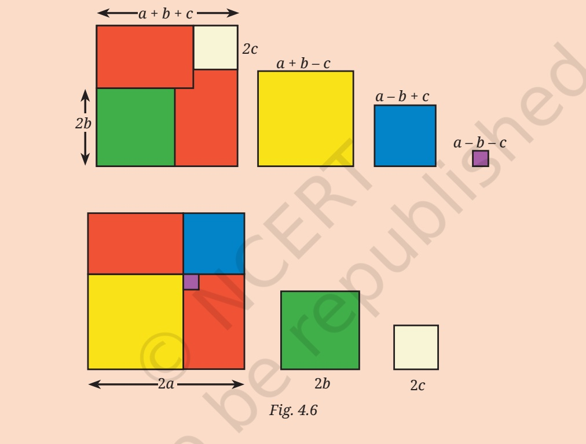

## Think and Reflect

1. Try to evaluate the following using a suitable identity: (i) $3 5 ^ { 2 }$ (ii) $6 5 ^ { 2 }$ (iii) $8 5 ^ { 2 }$ (iv) $1 0 5 ^ { 2 }$

Do you observe any interesting pattern?

2. Observe the two rows of figures below. They represent an algebraic identity. Try to identify it.

## 4.5 Factorisation Using Algebra Tiles

Consider a rectangle with sides $x + 3$ and $x + 4$ units.

We know that the area of such a rectangle is $\left(x+3\right)\left(x+4\right)$ sq. units. Using distributivity, we get

$$
(x + 3)(x + 4) = x^{2} + 3x + 4x + 12 = x^{2} + 7x + 12.
$$