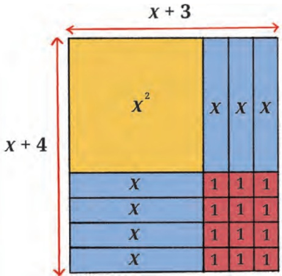

Fig. 4.7 helps to visualise the product of $x \quad + \quad 3$ and $x \; + \; 4$ using algebra tiles. The expression $x + 3$ is represented using an x-tile and three unit tiles. Similarly $x \quad + \quad 4$ is represented using an x-tile and four unit tiles. The product of these two linear factors is shown in the inner rectangle comprising the $x \mathrm { { - } t i l e } ,$ the x-tiles, and 12 unit tiles.

Fig. 4.7: Factorisation o $f x ^ { 2 } + 7 x + 1 2$

Note that the 7x in $x^{2} + 7x + 12$ has been split as $3x \pm 4x.$ This is represented by the fact that three x-tiles are placed on the right side of the x2-tile and four x-tiles are arranged below it. Also, the 12 unit tiles are arranged in a 3 by 4 array. Once the rectangular arrangement is formed, we observe that the dimensions of the rectangle are $x + 3$ and $x + 4$ units respectively.

## Think and Reflect

Suppose 7x is split as $2x + 5x;$ can a similar rectangular arrangement be formed? Consider other possibilities and check.

Fig. 4.7 helps us to visualise two algebraic identities:

(i) The linear expressions $x \mp 3$ and $x + 4$ can be multiplied to obtain the identity $(x + 3)(x + 4) = x^{2} + 7x + 12.$

(ii) Also the expression $x^{2} + 7x + 12$ can be factored into the linear factors $( x   +   3 )$ and $( x   +   4 )$ , giving the same identity $x^{2} + 7x + 12 =$ $(x + 3)(x + 4)$

## Think and Reflect

Algebra tiles can be used to represent products and find factors.

1. Figure out the product of $x + 2$ and $x + 3$ using algebra tiles.

2. Lay out algebra tiles for $x^{2} + 11x + 30$ in such a way that you will see its factors.