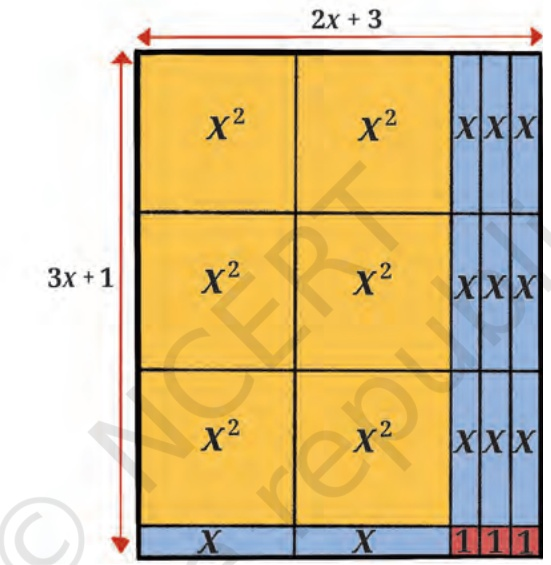

## Think and Reflect

We have seen that $(x + 3)(x + 4) = x^{2} + 7x + 12.$

$$
\mathrm{Also}\;(x+6)(x+7)=x^{2}+13x+42.
$$

Generalise the pattern to get an expression for $\left(x+a\right)\left(x+b\right)$

Now consider the case where we have a rectangle of sidelengths $2 x + 3$ and $3 x + 1$ , as shown in Fig. 4.8. What can you say about its area $\left(2x+3\right)\left(3x+1\right)?$

Fig. 4.8: Using algebra tiles to represent $( 2 x + 3 ) \times ( 3 x + 1 )$

Fill in the blanks with the appropriate expressions to make the equation true.

$$
( p x + a ) ~ ( \overline { { { q } } } x + b ) = ( \underline { { { \hphantom { x } } } } \hphantom { x } \hphantom { x } ) \chi ^ { 2 } + ( \underline { { { \hphantom { x } } } } \hphantom { x } \hphantom { x } \hphantom { x } ) \chi + \underline { { { \hphantom { x } } } } \hphantom { x } \hphantom { x } .
$$

Also, verify your answer using the distributive property.

## 4.6 Factorisation Without Using Algebra Tiles

Consider the algebraic expression $x ^ { 2 } + 7 x + 1 2$ which was obtained by multiplying the linear terms $x \: + \: 3$ and $x + 4$ . We also saw in Fig. 4.7 that 7x was split as $3 x   +   4 x$ so that a rectangle could be formed using the algebra tiles. But how do we achieve this ‘splitting of the $x \; \mathrm { t e r m } ^ { \ast }$ without using tiles?