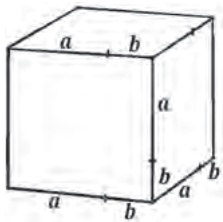

(v) $( 9 7 ) ^ { 2 }$ (vi) $( 1 8 \times 2 9 )$ (vii) $( 3 4 \times 4 3 )$ (viii) $( 2 0 5 ) ^ { 2 }$

3. Factor the following: (i) $9a^{2}+b^{2}+4c^{2}-6ab+12ac-4bc$ (ii) $1 6 s ^ { 2 } + 2 5 t ^ { 2 } - 4 0 s t$ (iii) $r ^ { 2 }   -   r   -   4 2$ (iv) $4 9 g ^ { 2 } + 1 4 g h + h ^ { 2 }$ (v) $6 4 u ^ { 2 } + 1 2 1 v ^ { 2 } + 4 w ^ { 2 } - 1 7 6 u v - 3 2 u w + 4 4 v w$

## Think and Reflect

James and Reshma were talking about algebraic identities they learnt in school.

James: $(a - b)^{2} \left( a + b \right) = (a^{2} - 2ab + b^{2})(a + b)$

Reshma: I have a different idea. $(a - b)^{2} (a + b) = (a - b) \left[ (a - b) (a + b) \right]$ (a – b)(a2 – b2)

I will find this product to get the answer.

According to you, who is correct and why?

Try to combine more such identities and find new results.

## 4.7 Finding New Identities

In this section we will play around with algebraic expressions to see if we can arrive at new identities.

What do you think $(a + b)^{3}$ will look like?

Let us find out the answer using the distributive property:

$$
(a+b)^{3}=(a+b)(a^{2}+2ab+b^{2})=a^{3}+3a^{2}b+3ab^{2}+b^{3}.
$$

Here we have found a new identity, namely,

$$
(a + b)^{3} = a^{3} + 3a^{2}b + 3ab^{2} + b^{3}.
$$

Let us try to visualise this identity. We saw that a square of side $a \; + \; b$ can be divided into squares and rectangles. This led us to the identity, $(a^{2}+b)^{2}=a^{2}+2ab+b^{2}$ . What if we have a cube of edge $a + b ?$ Can we divide a cube of edge $( a + b )$ into smaller cubes and cuboids and represent this new identity?

Fig. 4.9: A cube of edge a + b