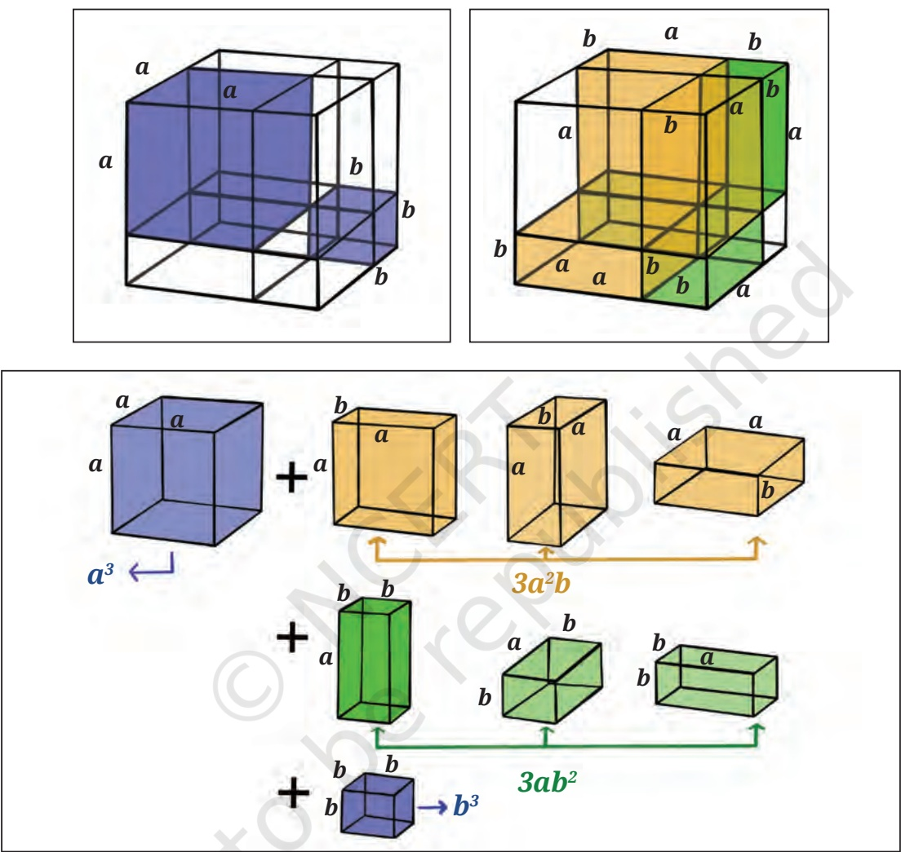

We know that the volume of this cube is $( a + b ) ^ { 3 }$ . Let us split this cube into smaller cubes and cuboids.

Fig. 4.10: Representation of the identity

$$
( a + b ) ^ { 3 } = a ^ { 3 } + 3 a ^ { 2 } b + 3 a b ^ { 2 } + b ^ { 3 }
$$

Notice that the larger cube can be split into two cubes and six cuboids. The cubes have volumes, $a ^ { 3 }$ and $b ^ { \overline { { 3 } } }$ cubic units, respectively.

Amongst the other six cuboids, three have dimensions a units × a units $\times \textit { b }$ units and other three have dimensions a units $\times b$ units × b units, and so their volumes are $a ^ { 2 } b$ and $a b ^ { 2 }$ cubic units, respectively. Hence the total volume of the six cuboids is $3 a ^ { 2 } b ^ { \mathrm { ~ + ~ } } 3 a b ^ { 2 }$