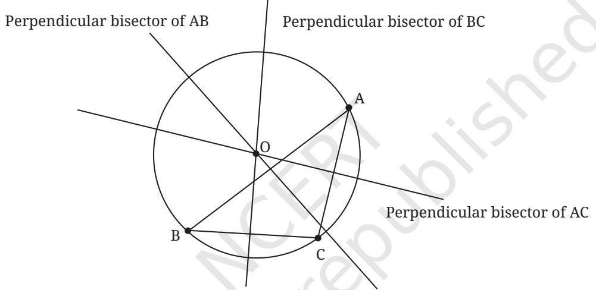
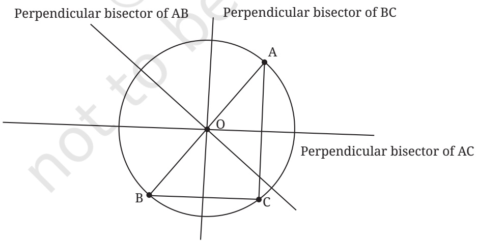

The centre O of the circle that passes through the vertices A, B and C of ΔABC is called the **circumcentre** of ΔABC (Fig. 5.5). The circle is called the **circumcircle** and is said to circumscribe the triangle. Conversely, the triangle is said to be inscribed in the circle. Since, the intersection of the perpendicular bisectors of AB and BC is a single point, there is just one such circle for a given triangle. Further, for an acute-angled triangle, the circumcentre lies inside the triangle (see Fig. 5.5). For an obtuse-angled triangle, the circumcentre lies outside the triangle (Fig. 5.6). And for a right-angled triangle, the circumcentre lies at the midpoint of the hypotenuse (Fig. 5.7).

Fig. 5.6: Obtuse-angled triangle: Circumcentre O is outside the triangle

Fig. 5.7: Right-angled triangle: Circumcentre O is at the midpoint of the hypotenuse