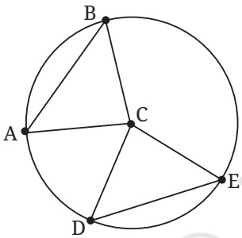
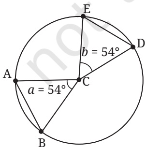

In the new position, the thread is another chord on the circle. What is common to the first and second chords? They have the same length, equal to the length of the thread. What about the angle subtended by the second chord at the centre? It must surely be the same as the angle subtended by the first chord at the centre. We now explain why this is true.

**Theorem 2:** Equal chords of a circle subtend equal angles at the centre of the circle.

What does the theorem say? It talks of two chords of the circle with equal length. In geometry, it always helps to draw a figure! (See Fig. 5.9). AB and DE are chords of the same length. We need to explain why ∠ACB is equal to $\angle  DCE$ . What are we given? $\mathrm{AB} = \mathrm{DE}$

To explain why two angles in two different triangles are equal, we use congruence of triangles. If the angles which we want to show equal are corresponding angles, then our task would be done!

Fig. 5.9

**Given:** $\mathrm{AB} \equiv \mathrm{DE}.$

**To show:** $\angle ACB = \angle DCE$

**Why is this true?** First, we see that $CA = CB = r$ , the radius of the circle.

Also, CD = CE = r. So, CA = CD and CB = CE.

But AB = DE is given! By the SSS congruence, ∆CAB is congruent to ∆CDE. So, ∠ACB is equal to $\angle  DCE _{:}$ , i.e., the angles subtended at the centre are equal.

Now suppose we have two chords that subtend equal angles at the centre. Are the chords equal? What does our intuition tell us? Let the chords be AB and DE. Let us use our imagination. Assume that B, A, E, and D are located clockwise on the circle as shown in Fig 5.10.

Fig. 5.10

Imagine you are standing at the centre C of a circle. Stretch your arms so that they are at a certain angle. Let your arms intersect the circle at A, B. The distance between your arm ends must be the length of chord AB. Now let the floor rotate magically. You start rotating (say clockwise) about C. Don’t change the angle your arms make! At some point your left arm meets point E.