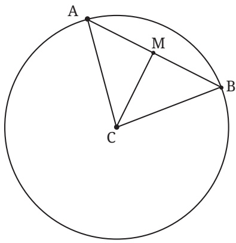

**Theorem 4:** The line joining the centre of a circle and the midpoint of a chord of the circle is perpendicular to the chord.

Fig. 5.12

Let us see why this is true. Draw a circle with centre C (Fig. 5.12). Draw any chord AB. Let M be the midpoint of AB. We must show that CM is perpendicular to AB.

**Explanation:** CAB is an isosceles triangle. AB is the base and $CA = CB$ $\mathrm{S}0,\angle \mathrm{A} = \angle \mathrm{B}$

M is the midpoint of AB. So, $\mathrm{AM} = \mathrm{BM}$

By the SAS congruence, ∆ CMA is congruent to $\Delta  CMB.    SO , \angle  CMB = \angle  CMA.$ But $\angle CMB \pm \angle CMA = 180^{\circ}$ (angles on a line).

So, both angles are 90°. That is, CM is perpendicular to AB.

## Exercise Set 5.3

1. Can you explain why the converse to Theorem 4 is true, i.e., why does the perpendicular from the centre of a circle to a chord of the circle bisect the chord?

(**Hint:** Use Fig. 5.12. You are told that $\angle CMA = \angle CMB = 90^{\circ}$ . You need to show that AM = BM.)

2. An isosceles triangle ABC is inscribed in a circle, with $\mathrm{AB} = \mathrm{AC}$ Show that the altitude from A to BC passes through the centre of the circle.

3. Two parallel chords of lengths 6 cm and 8 cm are on opposite sides of the centre of a circle. If the radius of the circle is 5 cm, find the distance between the midpoints of the chords.