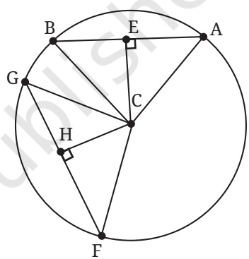

AE = FH (since AB = FG, and E and H are midpoints of AB and FG).

$$
\angle C E A = \angle C H F = 9 0 ^ { \circ } .
$$

CF = CA, as they are radii of the circle.

By the RHS congruence, ∆CEA ≅ ∆CHF.

So, CE = CH. Thus the chords of equal length are equidistant from the centre.

## Exercise Set 5.4

1. Use the Baudhāyana–Pythagoras theorem to show why Theorem 6 must be true.

2. Consider Fig. 5.15. If CE is perpendicular to AB, CH is perpendicular to GH, and CE = CH, show that AB = GF.

3. Solve the previous question using the Baudhāyana–Pythagoras theorem.

Question 2 in the exercise above establishes the following result.

**Theorem 7:** Chords of a circle that are equidistant from the centre have equal length.

Fig. 5.15

## 5.6.1 Which of the two unequal chords is farther from the centre?

You have two chords on a circle. One is longer than the other. Which chord is closer to the centre? Can you guess?

**Activity:** Draw a circle. Draw chords of various lengths. Drop a perpendicular to each chord from the centre. Record the length of the chord and its distance from the centre in a table.

Table 1

| Length of Chord |  |  |  |
| --- | --- | --- | --- |
| Distance from Centre |  |  |  |