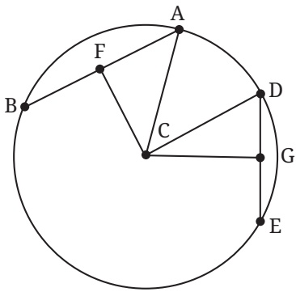

What do you observe? The longer the chord, the closer it is to the centre. Let us try to understand why this is true.

**Theorem 8:** Let AB and DE be two chords of a circle with centre C. Suppose $A B \geq D E ,$ . Then the distance from C to AB is less than the distance from C to DE.

As always, we draw the figure. Remember: by ‘distance from C to AB’ we mean the perpendicular distance. So, we drop perpendiculars CF and CG from C to AB and DE, respectively.

Fig. 5.16

**Given:** AB > DE.

**To show that:** CF < CG.

**Why is this true?** In Fig. 5.16, both AC and CD are radii. So, AC = CD. By the Baudhāyana–Pythagoras Theorem, $\mathrm{CD^{2} = CG^{2} + GD^{2}}$ and $\mathrm{AC^{2} = CF^{2} + AF^{2}}$

So, $\mathrm{CF^{2}+AF^{2}=CG^{2}+GD^{2}}$

Now AB is greater than DE. So AF is greater than GD (because F and G are the midpoints of AB and DE).

Since $\mathrm{AF^{2} \geq GD^{2}}$ we have $\mathsf { C F } ^ { 2 } \leq \mathsf { C G } ^ { 2 }$ So, CF < CG.

**Comment:** The chord nearest to the centre is the chord containing the centre. Its distance to C is zero! So the diameter is the greatest chord.

If one pushes the chord away from the centre, at some stage the chord becomes a single point, its length is zero, and the distance of C from this chord is the radius.

## Exercise Set 5.5

1. Find the length of the chord of a circle where the radius is 7 cm and perpendicular distance is 6 cm.

2. Explain why the following statement is true: If the perpendicular distance of a chord from the centre is d and the radius is r, then the chord length is $2 \sqrt { r ^ { 2 } - \boldsymbol { d } ^ { 2 } }$