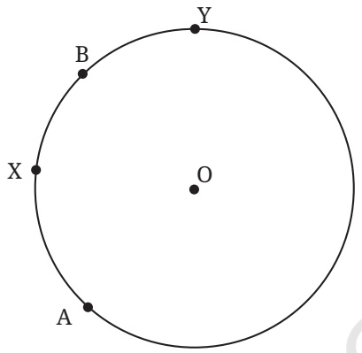
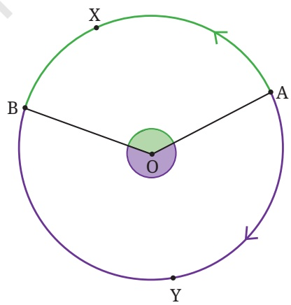

\*3. In a circle, if the distance of chord AB from the centre is twice the distance of another chord CD from the centre, then can we conclude that CD = 2 AB? Give reasons for your answer.

## 5.7 Angles Subtended by an Arc

An **arc** of a circle is a connected portion of the circle. It is defined by two points on the circle, called the **end points** of the arc, and the curve connecting them along the circle’s edge.

Fig. 5.17: Major arc AYB and minor arc AXB

Look at Fig. 5.17. A and B are two points on the circle. There are two ways of going from A to B. One goes via point X and one goes via point Y. The bigger of the two is called the major arc, and the smaller of the two is called the minor arc.

We define the **angle subtended** by the arc AB at the centre to be the measure of the angle AOB, as we sweep along the arc — so we move from OA to OB along the arc and measure the angle swept. The minor arc subtends the ∠AOB — here you move from OA to OB via X. The major arc subtends the angle we get as we move from OA to OB via Y (see Fig. 5.18).

Fig. 5.18