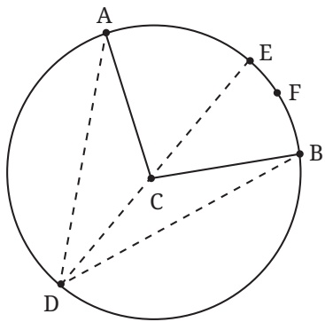

**Theorem 9:** The angle subtended by an arc at the centre of the circle is double the angle subtended by the arc at any point on the circle outside the arc.

Fig. 5.21: Angle subtended by arc AFB

**Given:** AFB is an arc. ∠ACB is the angle subtended by arc AFB at centre C. D is a point on the circle outside arc AFB (see Fig. 5.21).

We will assume for now that D is such that DC when extended cuts the circle at some point E on arc AFB, as shown.

We will consider the other case later.

**To show:** $\angle BCA = 2 \angle BDA$

**Why is this true?** Join D to C and extend DC to cut the circle at a point E on arc AFB. Now ∆DCB is isosceles with $CB = CD$ $\mathrm{S}0,\angle\mathrm{CBD}=\angle\mathrm{CDB}$

∠BCE is the exterior angle of $\Delta \mathrm { B C D } ,$ By the exterior angle theorem,

$$
\angle BCE = \angle CBD + \angle CDB = 2\angle BDC.
$$

Similarly, ∆ADC is an isosceles triangle with $\mathrm{CA}=\mathrm{CD}$

So,

$$
\angle CAD = \angle CDA
$$

$\angle \mathrm { A C E }$ is the exterior angle of $\Delta \mathrm { A D C } .$ By the exterior angle theorem,

$$
\angle ACE = \angle CAD + \angle CDA = 2\angle CDA.
$$

Now $\angle BCA = \angle BCE + \angle ECA,$ and $\angle BDA = \angle BDE + \angle EDA$

Hence

$$
\angle BCA = 2 ( \angle BDC + \angle CDA ) = 2 \angle BDA.
$$

So,

$$
\angle BCA = 2\angle BDA.
$$

The explanation we have given does not work if the situation is as shown in Fig. 5.22, where the extension of DC meets the circle at a point E outside the arc AFB. We must rework the explanation for this case.