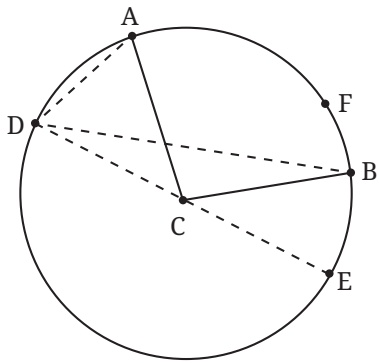
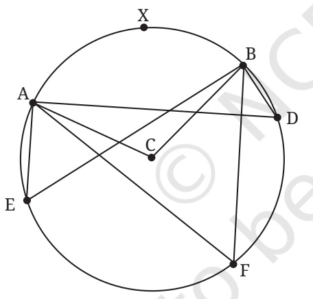

**Given:** AFB is an arc. ∠ACB is the angle subtended by arc AFB at centre C. D is a point on the circle outside arc AFB such that when we extend DC it cuts the circle at some point E outside the arc AFB, as shown (Fig. 5.22).

We shall again make use of the properties of isosceles triangles.

Fig 5.22: Angle subtended by arc AFB

$\angle ACE = \angle ADC + \angle CAD = 2\angle ADC,$ since $\mathrm{CA}=\mathrm{CD}$ (and so $\angle ADC = \angle CAD$ Similarly, $\angle BCE = \angle BDC + \angle CBD = 2\angle BDC.$ Also, $\angle ACB = \angle ACE - \angle BCE,$ and $\angle ADB = \angle ADC - \angle BDC.$ Hence $\angle ACB = 2 \angle ADB.$

Something very interesting comes out of this. This is what the activity before Theorem 9 suggested. Take an arc AB. Decide how you want to go from A to B along the arc. Take any point D on the circle, outside arc AB.

Then, no matter where D is, so long as it is outside the arc and on the circle, ∠ADB is the same!

Fig. 5.23: Angles subtended by an arc are equal

Let us understand this better using Fig. 5.23. Consider the arc of the circle going from A to B via X. The points on the circle outside this arc are points you cross as you go from A to B via E. The angle subtended by AXB at the centre is the angle swept by CA as we move from CA to CB via X. Points E, F and D are all not on AXB. The theorem tells us that $\angle \mathrm{AEB} = \angle \mathrm{ADB} = \angle \mathrm{AFB} = \frac{1}{2} \angle \mathrm{ACB}.$