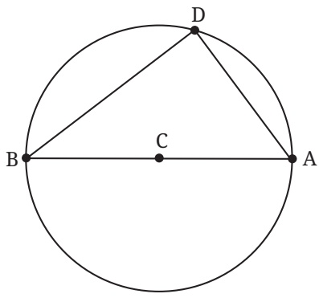
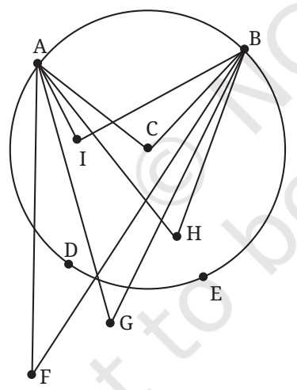

Corollary: The angle subtended by a diameter at any point on the circle is 90°.

Corollary: A corollary is a fact that follows immediately from an already proved result.

Fig. 5.24

**Why is this true?** Let AB be a diameter (Fig. 5.24). We must show that ∠ADB is $9 0 ^ { \circ }$ . The arc from A to B we take is the arc not containing D. What is the angle subtended by that arc at C? We have to move from A along that arc till we reach B. So, the angle subtended is $\angle  ACB$ , a straight angle, 180°. Hence, $\angle ADB = \frac{1}{2} \angle ACB = 90^{\circ}$

Fig. 5.25: Points and the chord

This fact that the angles in the same arc segment are all equal is a beautiful fact that distinguishes the circle from all other shapes.

In Fig. 5.25, the angles that arc AB subtends at the points F, G outside the circle are different. For the points inside the circle, $\angle \mathrm { A I B }$ $\angle  ACB$ and ∠AHB are all different. But for all points P on arc AB, the subtended angles are the same. Thus, for points D, $\angle ADB = \angle AEB$

## Exercise Set 5.6

1. In a circle with centre O, the central angle AOB is $6 0 ^ { \circ } .$ If the radius of the circle is 12 cm, what is the length of the chord AB?