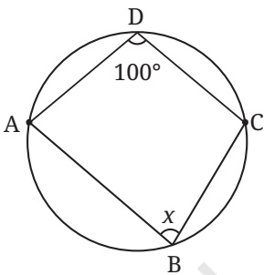
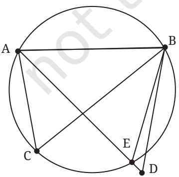
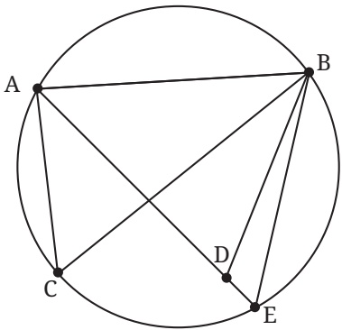

2. Let A and B be two points on a circle with centre O.

(i) Are there points X, Y on the circle, on the same side of AB,

such that ∠AXB is different from ∠AYB?

(ii) Is it true that if $\angle AXB = \angle AHB$ , then X and Y lie on the same side of the circle?

(iii) If $\angle AXB = \angle AHB$ , and X and Y do not lie on the circle, does the circle through A, B and X also pass through Y?

3. Find x in Fig. 5.26.

Fig. 5.26

## 5.8 Concyclicity of Points

Now we address the question about when 4 points lie on the same circle. And we will let you explore the question for 5 points, 6 points and so on! We call points that are on the same circle **concyclic**.

**Theorem 10:** If a line segment AB joining two points A, B subtends equal angles at two other points C, D that lie on the same side of AB, then the four points lie on a circle.

As always we draw the picture first.

**Given:** Consider segment AB. Points C and D lie on the same side of AB; points C and D are not on the line AB; and $\angle ACB = \angle ADB$

**To show:** A, B, C, D lie on the same circle.

**Why is this true?** The points A, B, C are noncollinear points. So, using Theorem 1, there is a circle passing through A, B, C.

Let us show that D also lies on that circle. For this, let us draw the circle through A, B and C.

Suppose D is not on the circle; then it is either inside or outside the circle. Join AD.

Fig. 5.27 A

Fig. 5.27 B