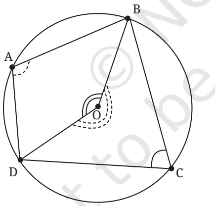

If D is outside the circle, then AD intersects the circle at E; see Fig. 5.27A. If D is inside the circle, extend AD to meet the circle at E; see Fig. 5.27B. Now C, E are on the same segment of the arc formed by chord AB. $\mathrm{S}0,\angle \mathrm{ACB}=\angle \mathrm{AEB}$

If D were outside the circle, then $\angle  AEB$ is an exterior angle of the ∆BED, so $\angle  AEB  > \angle  ADB$ . Also, $\angle AEB = \angle ACB$ (angles in the same segment of a circle), and $\angle ACB = \angle ADB$ (given). This leads to $\angle \mathrm { A C B }$ being greater than itself, which is obviously not possible.

If D were inside as in Fig. 5.27B, then $\angle  ADB$ is an exterior angle of BED. In the same way that we argued above, we reach an impossible conclusion.

So, we must eliminate both of these options (D being outside the circle and D being inside the circle). So, D must be on the circle passing through A, B, C. In other words, A, B, C, D are concyclic.

When the vertices of a quadrilateral (which we also call a **4-gon**) are concyclic, the quadrilateral is called a **cyclic** quadrilateral.

We use this to show another nice property of circles!

is 180°.

Fig. 5.28

**Given:** A, B, C, D are the vertices of a cyclic 4-gon (Fig. 5.28). This means that there is a circle passing through A, B, C, D. Let its centre be O.

**To show:** $\angle BAD + \angle BCD = 180^{\circ}$

**How shall we show that this is true?** Consider arc BCD; point A is on the circle and it lies outside the arc BCD. So ∠BAD is half the angle that arc BCD subtends at the centre O. Since we move from OB to OD along C, this is the reflex angle BOD (dotted). So, $\angle  BAD  = \frac{1}{2}$ (reflex angle BOD).