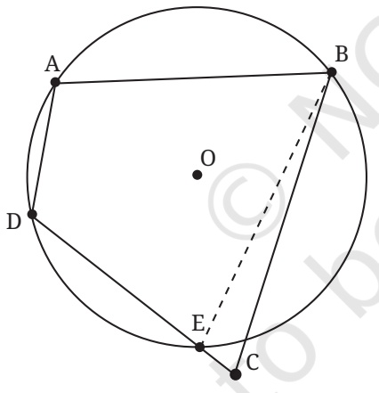

Similarly, $\angle  BCD$ is half the angle subtended by the arc BAD at O. This is the angle denoted by the double arc BOD. Since C is on arc BCD, we need to move from OB to OD via A. So, $\angle  BCD = \frac{1}{2} ( \angle  BOD  )$

$\mathrm{S}0,\angle \mathrm{BAD}+\angle \mathrm{BCD}=\frac{1}{2}$ (complete angle at the centre O)

A complete rotation at O is $3 6 0 ^ { \circ } ,$

Hence, $\angle BAD + \angle BCD = \frac{1}{2} \times (360^{\circ}) = 180^{\circ}.$

So, the opposite angles of a cyclic 4-gon add up to $1 8 0 ^ { \circ } ,$

The converse of this theorem also holds.

**Exercise:** A cyclic quadrilateral has angles measuring $\angle A = 80^{\circ}$ $\angle \mathrm{B} = 110^{\circ}, \angle \mathrm{C} = 100^{\circ}$ , and $\angle \mathrm{D} = 70^{\circ}$ . Can such a quadrilateral be drawn? Explain why or why not.

**Theorem 12:** If two opposite angles of a quadrilateral add up to $I 8 0 ^ { \circ } ,$ then the vertices of the quadrilateral lie on a circle, i.e., they are concyclic.

Fig. 5.29

**Given:** ABCD is a 4-gon (Fig. 5.29).

$$
\angle BAD + \angle BCD = 180^{\circ}.
$$

$$
\angle ABC + \angle CDA = 180^{\circ}.
$$

**To show that:** ABCD is cyclic.

**Why is this true?** Suppose ABCD is not cyclic. Since A, D, B are not collinear, there is a circle passing through the three points. If that circle does not pass through C, there are two cases: C is outside or C is inside the circle.

We deal only with the first case and leave the other to the reader. Let E be the point where CD meets the circle (see Fig. 5.29). Then ABED is a cyclic 4-gon. So from Theorem 11, $\angle BAD + \angle BED = 180^{\circ}$

We are also given $\angle BAD + \angle DCB = 180^{\circ}$

So $\angle BCD = \angle BED$ . But this is not possible as $\angle  BED$ is the exterior angle of BEC and hence greater than $\angle  BCE _{ z }$ i.e., greater than $\angle  BCD$

So, points A, B, C, D all lie on a circle.