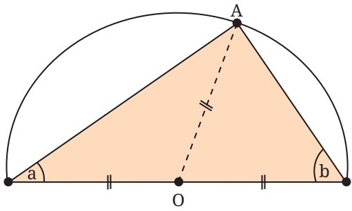
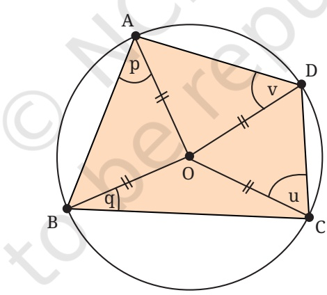

24. How would you use the following figure to justify the statement that the angle in a semicircle is $\bar { 9 0 ^ { \circ } ? }$

Fig. 5.30

\*25. In a circle, two chords CC' and DD' are drawn perpendicular to a diameter AB. Prove that the segment MM' joining the midpoints of the chords CD and C' D' is perpendicular to AB.

\*26. How would you use the following figure to justify the statement that the sum of the opposite angles of a cyclic quadrilateral is $1 8 0 ^ { \circ } ?$

Fig. 5.31

## Chapter Summary

A **circle** is the set of all points in a plane that lie at a given distance (the **radius**) from a fixed point called its **centre**.

• A circle has **reflection symmetry** across any diameter.