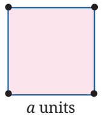
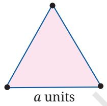
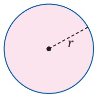
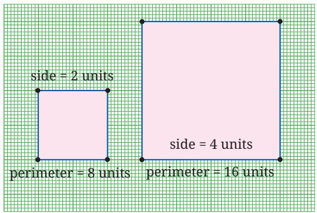

## 6.1 Perimeter of a Shape

Given any shape, its **perimeter** is the total length around its border. Imagine a tiny insect going for a walk around its border, never turning around, till it returns to its starting point. The perimeter of the shape is the total distance it travels.

So, a square with side a units has perimeter 4a units. An equilateral triangle with side a units has perimeter 3a units.

Fig. 6.2 A

Fig. 6.2 B

The perimeter of a rectangle with length a units and width b units is $2 ( a + b )$ units. Note that the formula for the perimeter of a square is a ‘special case’ of the formula for the perimeter of a rectangle with a = b.

Fig. 6.3

Here we see a circle with radius r units. What is its perimeter? How do we find out?

## Think and Reflect

What is the connection between this question and the one about the 400 m athletics track?

To answer the question about the perimeter of the circle, we must go step by step.

What happens to the perimeter of a square if we double its side? It doubles too. The ratio of perimeter to the side is 4:1; this is so for all squares. As the side of the square gets larger (or smaller), the ratio of perimeter to side stays fixed at 4:1.

Fig. 6.4: Ratio of perimeter to side is 4:1