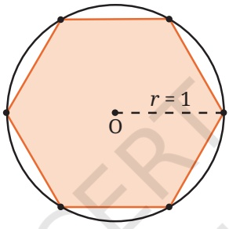
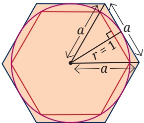

which we now call π (we say ‘pi’ as in ‘pie’ and not as in ‘pizza’), represents a bridge between many different areas of mathematics, and connects the straight-edged world of polygons with the infinite curves of nature. While early civilisations relied on practical, ʻgood-enoughʼ values for construction and trade, the pursuit of this ratio eventually became an important pastime of mathematicians that helped to benchmark the sophistication of mathematical theories.

In Mesopotamia (c. 1900 BCE), mathematicians moved beyond the crude integer value of 3. They realised that a circle had a perimeter that was slightly larger than the hexagon inscribed within it. They concluded that π should therefore be larger than 3, and they set the value of π to be $3 + { \frac { 1 } { 8 } } = 3 . 1 2 5$

Fig. 6.6 The Mesopotamian Hexagon-to-Circle comparison. Can you see why this shows that $\pi \geq 3 ?$

By **250 BCE, Archimedes of Syracuse** brought a new level of rigor to the problem. He ‘trapped’ the value of π between the perimeters of inscribed and circumscribed polygons. By using both an inscribed and circumscribed hexagon, Archimedes showed that π is between 3 and $2 { \sqrt { 3 } } \approx 3 . 4 6$ . Working his way up to 96-sided polygons, Archimedes found that 3 $\frac{10}{71} < \pi < 3\frac{1}{7}$

Fig. 6.7: Archimedes’ method utilising inscribed and circumscribed polygons. Can you see why this diagram of an inscribed and circumscribed hexagon tells us that π is between 3 and $2 { \sqrt { 3 } }   { ? }$ (Hint: Use the Baudhāyana–Pythagoras Theorem.)