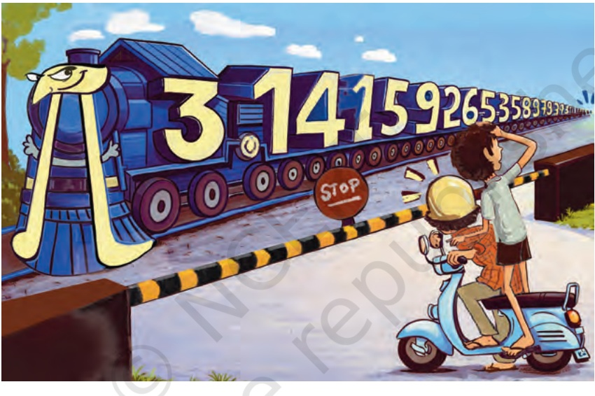

Since π is irrational, there is no ‘best fraction’ for π. If there is any fraction that is close to π, we can find another fraction that is closer.

The well-known fraction $\frac { 2 2 } { 7 }$ is good enough for most practical uses. But it is important to note that π is not equal to $\frac { 2 2 } { 7 }$ (they are ‘close but not equal’). So we write $\pi \approx { \frac { 2 2 } { 7 } }$ and also $\pi   \neq   \frac { 2 2 } { 7 }$ . In the same way, we can write ${ \sqrt { 2 } }   \approx 1 . 4 1 4$ and also ${ \sqrt { 2 } }   \neq 1 . 4 1 4$

As noted earlier, a much better approximation for π is ${ \frac { 3 5 5 } { 1 1 3 } } .$

## Fun Fact

Here’s a fun way to remember the first few digits of π: How I wish I could recollect $p i .$

Count the number of letters in each word (3, 1, 4, 1, 5, 9, 2) and you get the digits of π! So, $\pi \approx 3 . 1 4 1 5 9 2 .$ …

Since $\bar { \pi } \approx 3 . 1 4$ and also $\pi \approx { \frac { 2 2 } { 7 } }$ , March 14 (written $3 - 1 4$ in North America) is celebrated each year as **Pi Day**, and 22 July (written ‘22-7’ in