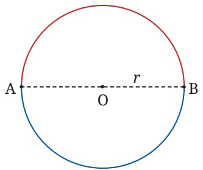
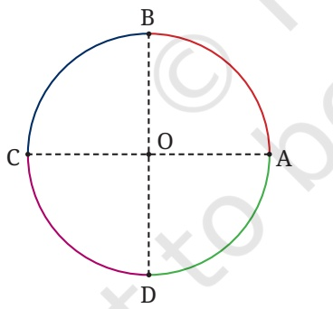

India) is celebrated each year as **Pi Approximation Day**.

## 6.4 Length of an Arc of a Circle

Fig. 6.8: Two semicircles making a full circle

The circumference of a circle of diameter d is π d. Since the diameter is twice the radius, we can also write the circumference of a circle as 2πr, where r is the radius.

What will be the length of a **semicircle** with the same radius r (see Fig. 6.8)?

If we reflect the circle in the diameter AB, the red semicircle and the blue semicircle exchange places. This means that they have equal length, which is $2\pi r \div 2 = \pi r$

Instead of reflecting the figure in the diameter AB, we can also imagine rotating the whole figure around the centre O through an angle of $1 8 0 ^ { \circ }$ , i.e., through a half-turn. The effect is the same, and we get the same formula for the length of the semicircular arc.

Fig. 6.9: Four quarter circles make a full circle

What will be the length of a **quarter circle** with the same radius (Fig. 6.9)?

Imagine rotating the entire figure through $9 0 ^ { \circ } ,$ , clockwise or anticlockwise. Each quarter circle moves and covers another quarter circle. So each quarter circle has the same arc length, and this is equal to $2 \pi r \div 4 = \frac{\pi r}{2}.$

Note the following:

• The formula for the length of a semicircle may also be written as $2 \pi r \times \frac { 1 8 0 ^ { \circ } } { 3 6 0 ^ { \circ } }$