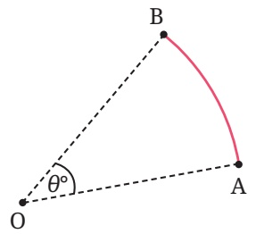
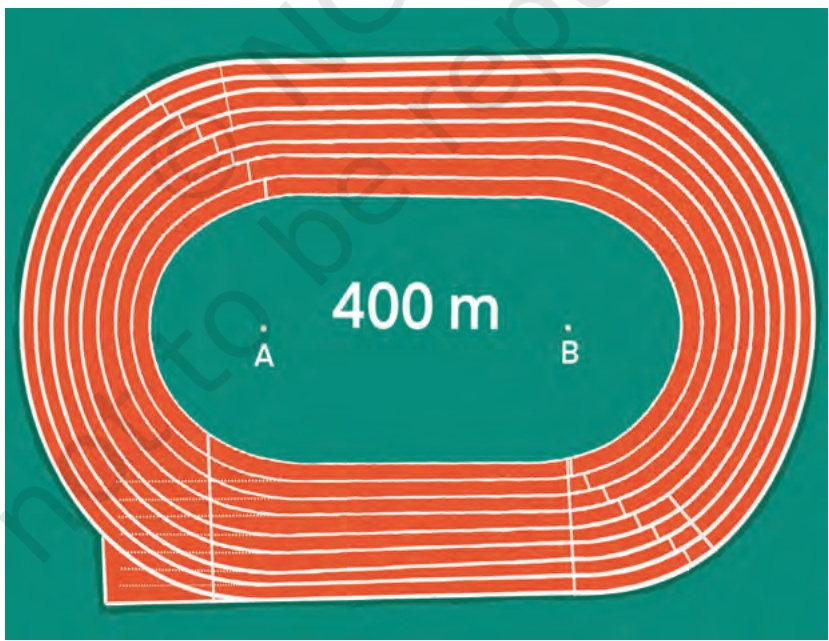

• The formula for the length of a quarter circle may also be written as $2 \pi r \times \frac { 9 0 ^ { \circ } } { 3 6 0 ^ { \circ } }$

From these, we can guess the formula for the length of an arc of a circle in terms of the angle it makes (i.e., the angle it ‘subtends’) at the centre of the circle.

Fig. 6.10: Length of an arc of a circle

If the arc is AB, and it subtends an angle $\theta ^ { \circ }$ at the centre O of the circle, the length of the arc is $2 \pi r \times \frac { \theta ^ { \circ } } { 3 6 0 ^ { \circ } }$

## A Closer Look at a 400 m Athletics Track

Fig. 6.11: Schematic diagram of a 400 m athletics track