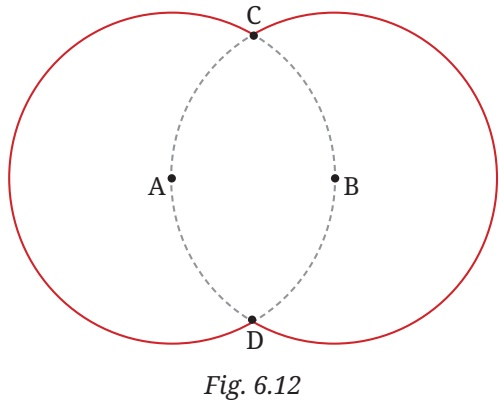
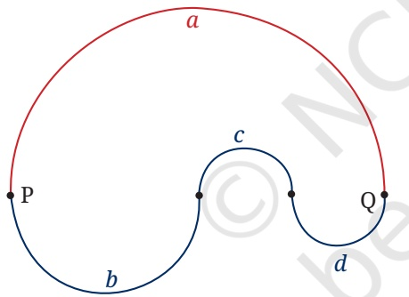

Here, we have two congruent circles centered at A and B. Each one passes through the centre of the other one. The circles intersect at C and D. We need to find the total length of the two red arcs shown here, in terms of the radius r unit.

Consider the triangle with vertices A, B, C. Since $\mathrm { A B } = r ,$ $AC = r, BC = r,$ the triangle is equilateral, hence $\angle CAB = 60^{\circ} =$ $\angle \mathrm { C B A }$

Similarly $\angle BAD = 60^{\circ} = \angle ABD$ . It follows that $\angle CAD = 120^{\circ} = \angle CBD.$

Hence, each dotted arc is $\frac { 1 } { 3 }$ of the circumference of the circle on which it lies. Hence, the total length of the two red arcs is $2 \times \frac{2}{3} \times 2\pi r = \frac{8}{3}\pi r$

Fig. 6.13

**Example 2:** In Fig. 6.13, we see points P and Q and two paths connecting them. The first path is made up of the semicircle a. The other path is made up of three semicircles (b, c and d). Which path is longer? Choose one: (i) Path a is longer. (ii) Path $b \; + \; c \; + \; d$ is longer. (iii) The two paths have equal length. (Try to answer this before reading on.)

Let us solve the problem using algebra. Let the radii of the semicircles $a , b , c ,$ d be denoted by $\bar { a ^ { \prime } } , \bar { b ^ { \prime } } , \bar { c ^ { \prime } }$ and $d ^ { \prime }$ . Then the length of semicircle $a \mathrm{i}s \frac{1}{2} (2\pi) a' = \pi a'.$ . Similarly, the lengths of the semicircles $b , \; c ,$ and d are $\pi b ^ { \prime } ,   \pi c ^ { \prime }$ and πd'. So, the length of the second path is $\pi ( b ^ { \prime } + c ^ { \prime } + d ^ { \prime } )$ , and that of the first path is $\pi a ^ { \prime } .$

Which is bigger, $b' + c' + d'$ or $a ^ { \prime } \nmid$ Do you see that neither one is bigger? They are equal! Because, the length of PQ is $2 a ^ { \prime }$ and it is also equal to $2b' + 2c' + 2d'$ . It follows that $a^{\prime} = b^{\prime} + c^{\prime} + d^{\prime}$ . Hence, the two paths have equal length!