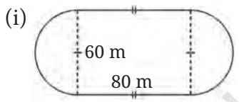
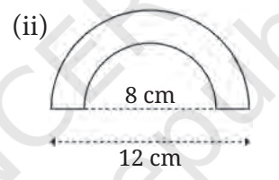
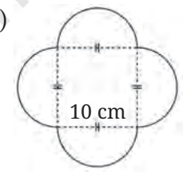
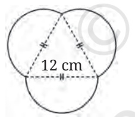
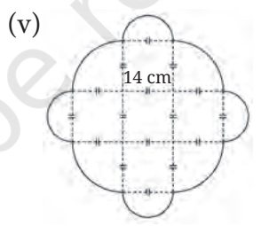
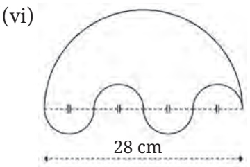
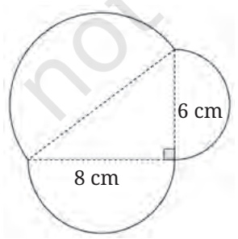
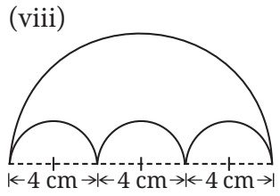
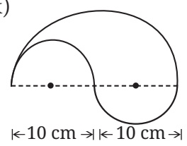

## Exercise Set 6.1

Unless stated otherwise, use the approximation $\frac { 2 2 } { 7 }$ for π.

1. The perimeter of a circle is 44 cm. What is its radius?

2. Calculate, correct to 3 significant figures, the circumference of a circle with: (i) radius 7 cm (ii) radius 10 cm (iii) radius 12 cm.

3. Calculate the length of the arc of a circle if: (i) the radius is 3.5 cm and the angle at the centre is 60°, and (ii) the radius is 6.3 m and the angle at the centre is 120°.

4. Find the perimeter of a sector (i.e., the curved portion as well as the two straight portions) of a circle of radius 14 cm and sector angle $7 5 ^ { \circ }$

5. Find the perimeters of the following shapes (taking the arcs to be quarter or half or three-quarters of a circle, as appropriate) (Fig. 6.14i to 6.14ix):

(iii)

(iv)

(vii)

Fig. 6.14

(ix)

