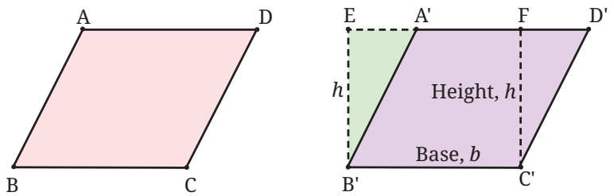
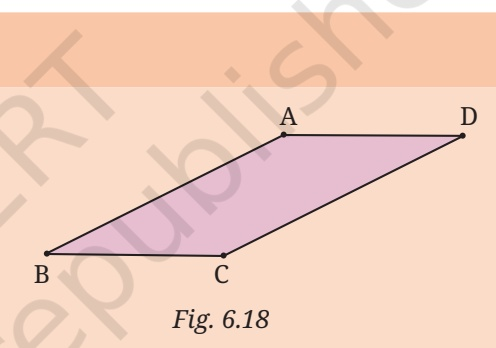
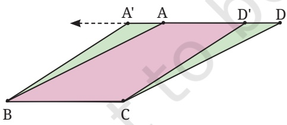

Fig. 6.17: Area of a parallelogram. Here, A'B'C'D' is a copy of ABCD.

Fig. 6.17 shows how to transform a parallelogram ABCD into a rectangle EB'C'F (at right; here, parallelogram A'B'C'D' is a copy of ABCD) with the same base b and same height h. Though the two shapes are different, their areas are the same. So, the area of the parallelogram is equal to base × height = bh.

## Think and Reflect

What happens if the parallelogram is ‘thin’ (Fig. 6.18) and the foot of the perpendicular from C to AD does not lie on side AD? The construction then does not seem to work. How do we fix this ‘gap’?

Here is a hint on how the problem of the ‘thin parallelogram’ can be solved.

Fig. 6.19: The thin parallelogram

Select a point D' on DA, close to D, and a point A' on DA extended, with A'A = D'D (Fig. 6.19). Then A'BCD' is a parallelogram, and since $\Delta  CDD  \cong \Delta  BAA$ , its area is the same as that of ABCD. Now repeat this step as many times as needed.

## Think and Reflect

The area of a rectangle can be found when we know the lengths of its sides. Is the same true for a parallelogram? That is, can we find the area of a parallelogram when we know the lengths of its sides? Why or why not?