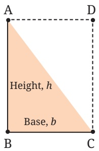
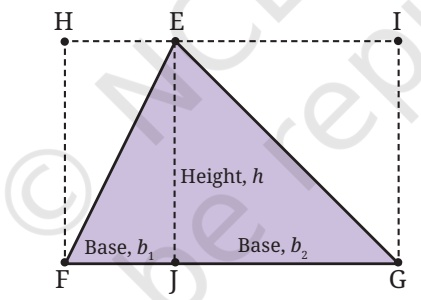
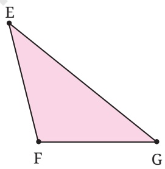
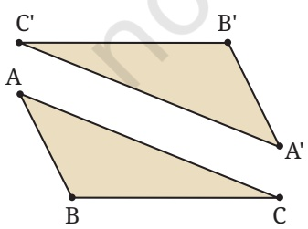
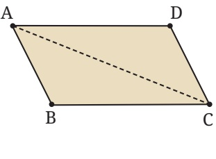

(**Hint**: What happens to the area of a parallelogram if we decrease or increase the angle between the adjacent sides while keeping the lengths fixed?)

## 6.8 Area of a Triangle

Next, we work out a formula for the area of a triangle. (You have seen the formula in Grade 8, but we will go over the idea again, briefly.) One way to proceed is to first consider the case of a right-angled triangle and then other triangles. In both cases, we enclose the triangle in a rectangle; then we use the formula for area of a rectangle. (See Fig. 6.20A. Notice that $\mathrm{FG}=\mathrm{FJ}+\mathrm{JG}$ and so $b = b_{_1} + b_{_2}.)$ We find as a result that the area of a triangle with base b units and height h units is half the area of the rectangle with base b units and height h units. That is, the area is equal to $\frac { 1 } { 2 }$ bh sq. units.

You may wonder, like earlier, is there a gap in our argument? What would we do if angle EFG is obtuse and the triangle were shaped like triangle EFG in Fig. 6.20B? Please work out the answer to this question.

Fig. 6.20A: Area of a triangle

Fig. 6.20B

A nicer way of working out the formula for the area of a triangle is by seeing that two congruent copies of a triangle can be fitted together to make a parallelogram.

Fig. 6.21A

Fig. 6.21B

In Fig. 6.21A, triangles ABC and A'B'C' are congruent. They fit together as in Fig. 6.21B to make a parallelogram.