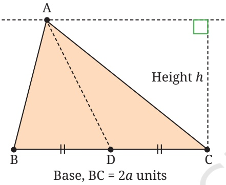

Do you see why the two triangles fit together to make a parallelogram? (If you study the angles in the figure $( \mathrm{e.g.,} \angle \mathrm{B^{\prime}C^{\prime}A^{\prime}}$ and ∠BCA), you will see why this is so. Keep in mind the criterion by which we check whether two lines are parallel.)

We already know, area of a parallelogram: base × height = bh.

So, the formula for the area a triangle is $\frac{1}{2} \left(  base  \times  height  \right) = \frac{1}{2}   bh.$

**A property of the median of a triangle**. From the above formula we reach a simple but beautiful conclusion about any of the medians of a triangle.

Fig. 6.22

A median is the line segment joining a vertex of the triangle to the midpoint of the opposite side. In Fig. 6.22, AD is a median of $\Delta \mathrm { A B C }$

Consider $\Delta \mathrm { A B D }$ and ΔACD. Their bases are equal $\mathrm{BD} = \mathrm{DC}$ and they have equal height h. Using the formula for the area of a triangle, we see that they have equal area $\frac{ah}{2} \leq 9.$ units!

We state this as a theorem.

**Theorem**: A median of a triangle divides it into two triangles with equal area.

Does this come as a surprise? It should! After all, ΔABD and ΔACD are (in general) differently shaped (i.e., not congruent to each other). But we have just proved that they have the same area!

## Think and Reflect

Since ΔABD and ΔACD have equal area, you may wonder — Can we divide ΔABD using straight cuts into two or more pieces that we can then rearrange to exactly cover $\Delta \mathrm { A C D ? }$ What do you think? Is it possible?

We shall spoil the surprise by revealing that it is possible. But we will not tell you the least number of pieces required. Try to find the answer!