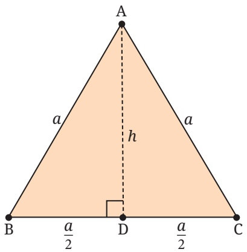
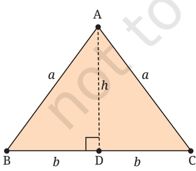

All three sides have length a, so the semi-perimeter is $s = \frac{1}{2}(a + a + a) = \frac{3}{2}a$ units. Heron’s formula now yields,

area of triangle $\sqrt{\frac{3}{2}a\left(\frac{1}{2}a\right)\left(\frac{1}{2}a\right)\left(\frac{1}{2}a\right)}=\frac{\sqrt{3}}{4}a^{2}$ sq. units

Fig. 6.23

Let us check this against the ‘half base times height’ formula. Let h units be the height of the triangle. Then, by the Baudhāyana–Pythagoras theorem,

$$
a^{2}-h^{2}=\frac{a^{2}}{4}, \quad \therefore h^{2}=\frac{3a^{2}}{4}, \quad \therefore h=\frac{\sqrt{3}}{2}a
$$

So the area is $\frac{1}{2} \times \frac{\sqrt{3}}{2}a \times a = \frac{\sqrt{3}}{4}a^{2}$ sq. units. Same formula!

**Note:** Notice the symbol $\therefore$ . This symbol is used regularly by mathematicians; it means and is read as ‘therefore’.

**Example 4:** An isosceles triangle with equal sides a units and base 2b units.

The semi-perimeter is $\frac{1}{2}(a + a + 2b) = a + b$ units. Heron’s formula now yields,

area of the triangle $e = \sqrt{(a + b)(a + b - a)(a + b - a)(a + b - 2b)} = b\sqrt{a^{2} - b^{2}}$ sq. units.

Fig. 6.24

Let us check this against the ‘half base times height’ formula. Let h units be the height of the triangle. Then, by the Baudhāyana–Pythagoras theorem,

$$
a^{2}-h^{2}=b^{2},\quad \therefore h^{2}=a^{2}-b^{2},h=\sqrt{a^{2}-b^{2}}.
$$

So the area is $\frac{1}{2} \times \sqrt{a^{2} - b^{2}} \times 2b = b\sqrt{a^{2} - b^{2}}$ sq. units, the same as earlier.