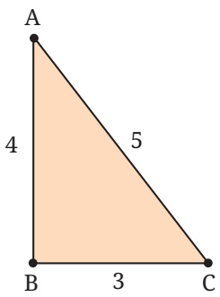
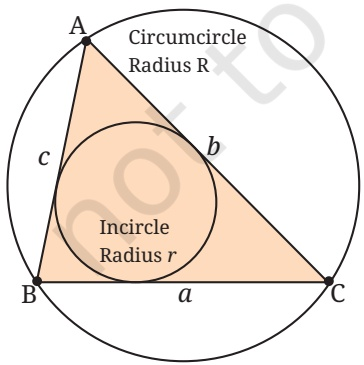

**Example 5:** A triangle with sides 3 units, 4 units and 5 units.

The semi-perimeter is $s = \frac{1}{2}(3 + 4 + 5) = 6$ units. Heron’s formula now yields,

area of triangle $\sqrt{6 \times (6 - 3) \times (6 - 4) \times (6 - 5)} = \sqrt{6 \times 3 \times 2} = 6$ sq. units.

Fig. 6.25

Let us check this against the ‘half base times height’ formula. See Fig. 6.25; note that $3 ^ { 2 }   +   4 ^ { 2 }   =   5 ^ { 2 }$ . Therefore, by the converse of the Baudhāyana–Pythagoras hypotenuse theorem, ΔABC is right-angled at B. So,

base = 3 units, height = 4 units,

so the area is $\frac{1}{2}( base  \times  height ) = \frac{1}{2}(3 \times 4) = 6.$ sq. units, the same as earlier.

We get the correct result in each case.

You may wonder how Heron’s formula is proved. There are many proofs known; one of them uses the Baudhāyana–Pythagoras theorem and repeated use of the ‘difference-of-two-squares’ formula $a^{2}-b^{2}=(a-b)(a+b)$ . We will study some of these proofs in Grade 10.

There are two other such formulas for the area of a triangle. Both have a connection with circles. See Fig. 6.26.

Given any triangle ABC, there is exactly one circle that passes through its three vertices. This is called the **circumcircle** of $\Delta \mathrm { A B C }$

There is also exactly one circle that fits tightly in the triangle, touching its three sides. This is called the **incircle** of ∆ABC.

Fig. 6.26

Let the sides of $\Delta \mathrm { A B C }$ be a, b, and c. Let the radius of the circumcircle be R. Let the radius of the incircle be r. Then we have the following two formulas for the area:

$$
\mathrm{Area}   of   \Delta \mathrm{ABC} = \frac{abc}{4R}
$$

$$
\mathrm{Area}   of   \Delta \mathrm{ABC} = \frac{r(a + b + c)}{2}
$$