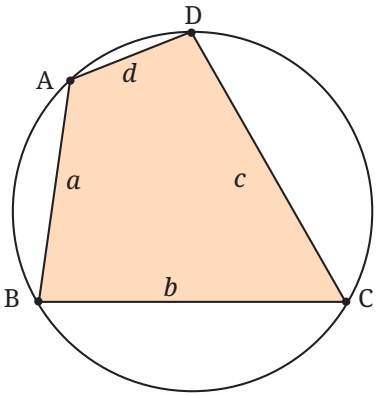
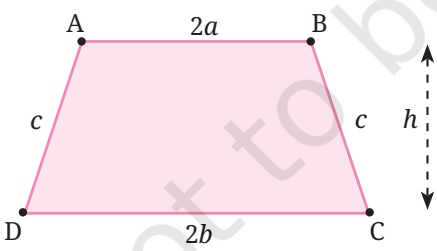

Fig. 6.28: A cyclic 4-gon

The formula states that if the sides of the cyclic 4-gon have lengths $a ,   b ,   c ,   d ,$ and the semi-perimeter s is $\frac{1}{2}(a + b + c + d)$ , then: Areaof $4-\mathrm{gen}=\sqrt{(s-a)(s-b)(s-c)(s-d)}$

It is an amazing and beautiful formula! Does it not remind us of Heron’s formula for the area of a triangle?

We can verify that the formula works out correctly in various special cases.

**Example 6:** Verify Brahmagupta’s formula for the case of a rectangle. All rectangles are cyclic, so Brahmagupta’s formula should apply. Let the sides of the rectangle be a, b. Then $s = \frac{1}{2}(2a + 2b) = a + b$ , so the formula yields:

$$
\mathrm{Area}=\sqrt{(a+b-a)(a+b-b)(a+b-a)(a+b-b)}=\sqrt{ab\cdot ab}=ab,
$$

which is correct. Please check out the formula against other special cases. **Example 7:** Verify Brahmagupta’s formula for the case of an isosceles trapezium.

Fig. 6.29: Isosceles trapezium

All isosceles trapezia are cyclic, hence the formula should apply. The perimeter is $2 a \; + \; 2 b \; + \; \bar { 2 c } _ { \mathrm { s } }$ , so $s = a + b + c.$ . Hence, the area as given by the formula should be

$$
\sqrt{(s - 2a)(s - 2b)(s - c)(s - c)}
$$

Since $s - 2a = c + b - a, \; s - 2b = c + a$ $-2b,   s-c=a+b$ the above formula simplifies to

$$
(a+b)\sqrt{(c+b-a)(c+a-b)}=(a+b)\sqrt{c^2-(b-a)^2}.
$$