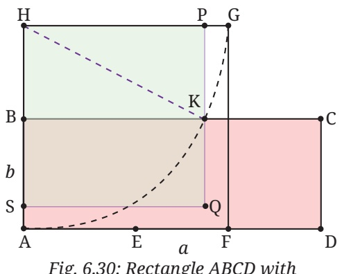

a square with area ab sq. units. Here is a slightly simplified form of Baudhāyana’s construction (Fig. 6.30).

• Given: rectangle ABCD with $\mathrm{AD} = a, \mathrm{AB} = b   where   a > b.$

Fig. 6.30: Rectangle ABCD with AD = a, AB = b

• Locate E on AD so that $AE = AB.$

• Locate the midpoint F of ED.

• Draw square AFGH with side AF and vertex H on AB produced.

• Draw arc AG with centre H. Let arc AG cut side BC at K.

• Draw a line through K parallel to AH. Let it cut GH at P.

• Draw square HPQS with HP as side. Then square HPQS has the same area as rectangle ABCD.

Try to work out why this method works. You will find that it is a geometrical translation of the formula $\left( \frac{a + b}{2} \right)^{2} - \left( \frac{a - b}{2} \right)^{2} = ab$

## \*Why does this method work?

Refer to Fig. 6.30. From $AE = b$ we get $\mathrm{AF}=\frac{\mathrm{AE}+\mathrm{AD}}{2}=\frac{a+b}{2}$ Hence, $\mathrm{HG} = \frac{a + b}{2} = \mathrm{HK}$ as HK is a radius of the circle.

Next, $BH = AH - AB = AF - AB = \frac{a + b}{2} - b = \frac{a - b}{2}$

Now consider the right-angled triangle HKP. Using the Baudhāyana– Pythagoras theorem we get

$$
\mathrm{HP}^{2}=\mathrm{HK}^{2}-\mathrm{BH}^{2}=\left(\frac{a+b}{2}\right)^{2}-\left(\frac{a-b}{2}\right)^{2}=
$$

$$
\frac{a^{2}+2ab+b^{2}}{4}-\frac{a^{2}-2ab+b^{2}}{4}=\frac{ab}{2}+\frac{ab}{2}=ab.
$$

Therefore square HPQS has the same area as rectangle ABCD.