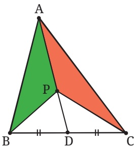
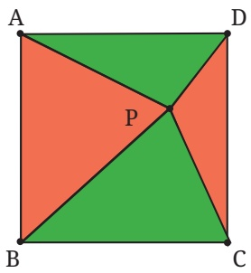
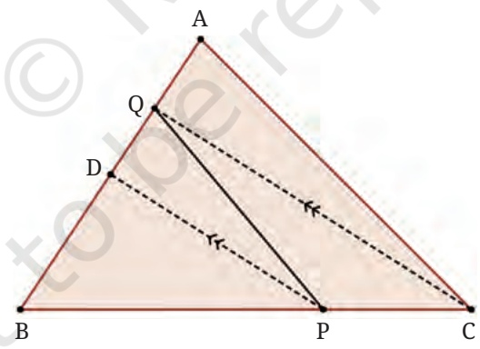

the 4-gon thus formed is always a parallelogram, and if so, why? These questions will be tackled and answered in the chapter on quadrilaterals.)

9. In ∆ABC, the midpoint of BC is D (Fig. 6.32). Median AD is drawn. P is any point on AD. Show that area (∆ABP) = area (∆ACP).

Fig. 6.32

Fig. 6.33

10. Given a square ABCD, let P be a point within it. Join PA, PB, PC, PD (Fig. 6.33). What is the ratio of the areas of the red region (∆PAB and ∆PCD) and the green region (∆PBC and ∆PDA)?

11. In ∆ABC, D is the midpoint of AB. P is any point on BC, and Q is a point on AB such that CQ || PD. PQ is joined (Fig. 6.34). Prove that Area $( \Delta \mathrm{BPQ} ) = \frac{1}{2}$ Area (∆ABC).

Fig. 6.34

## 6.10 Area of a Circle

A circle is an extremely basic shape; it is easy to draw if we have a rope and a peg to which the rope can be tied. Human beings have used the circular shape in their settlements, buildings and tools for thousands of years.