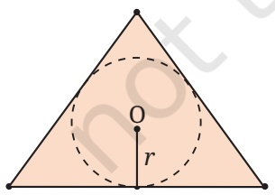
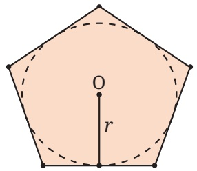
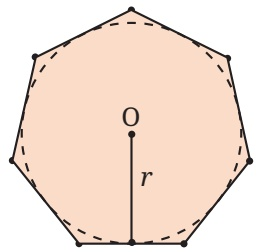

this may also be written as $A \approx \left( \frac{64}{81} \right) 4 r^2, \quad \mathrm{i.e.}, \quad A \approx \left( \frac{256}{81} \right) r^2.$

Amazingly, the same formula appears in the Baudhāyana Śhulbasūtra (800 BCE) via a geometric method for constructing a square with (approximately) the same area as a circle.

## The Familiar Formula in Use Today

The ancient Greeks also knew that $\frac { A } { r ^ { 2 } }$ is some constant — but did not know what that constant was. Two different civilisations approximated it to be $\frac { 2 5 6 } { 8 1 }$

Finally, in c. 250 BCE, Archimedes showed that the constant is exactly π (i.e., the same constant that occurs in the formula for perimeter of a circle!); so, $A \; = \; \pi r ^ { 2 }$ He expressed the formula this way: “The area of a circle is equal to the area of a right angle triangle with sides equal to the radius and the circumference of the circl $e ^ { \flat }$ That is,

$$
\mathrm{Area}   of circle =\frac{1}{2}\times\mathrm{circm}   forence \times\mathrm{radius}=\frac{1}{2}\times2\pi r\times r=\pi r^{2}.
$$

The proof given by Archimedes is very clever. It is based on a property shared by all regular polygons: The area enclosed by a regular polygon is equal to half the perimeter × the radius of the circle that fits tightly within the polygon (Fig. 6.36). (The proof of this formula is an extension of the proof of the formula of the area of a triangle in terms of the radius of its incircle.)

1 Fig. 6.36: Area of a regular polygon = 2 × perimeter of the polygon × radius