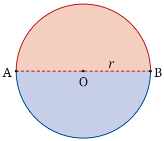
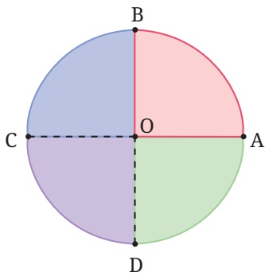

Fig. 6.39: Area of a semi-circular disc

By symmetry, we see that the area of a semicircular disc is $\left( { \frac { 1 8 0 } { 3 6 0 } } \right) ^ { \mathrm { t h } } = { \frac { 1 } { 2 } }$ of the area of the circle, i.e., $\frac { 1 } { 2 }   \pi r ^ { 2 }$

We could use the reflection symmetry of the circle to understand this result.

By symmetry, we see that the area of a quarter circular disc is $\left( { \frac { 9 0 } { 3 6 0 } } \right) ^ { \mathrm { t h } } = { \frac { 1 } { 4 } }$ of the area of the circle, i.e., $\frac{1}{4} \pi r^{2}$

We could also use the quarter-turn symmetry of the circle to understand this result.

Fig. 6.40: Area of a quarter circular disc

Examining the above, we immediately obtain the desired formula for a general sector:

**Formula for the area of a sector of a disc** in terms of the angle it subtends at the centre of the circle

If the arc is $\mathrm { A B } ,$ and it subtends an angle of $\theta ^ { \circ }$ at the centre O of the circle (see Fig. 6.38), then the area of the sector is

$$
\pi r ^ { 2 }   \times   { \frac { \theta ^ { \circ } } { 3 6 0 ^ { \circ } } } .
$$

Note how we have used the rotational symmetry of a circle in deducing these formulas.

Related to a sector, there is a part of the circular region called a segment. A **segment** of a circle is the region bounded by an arc of the circle and the chord joining the endpoints of the arc.