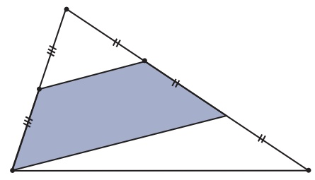
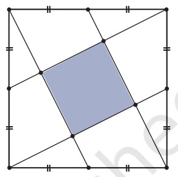
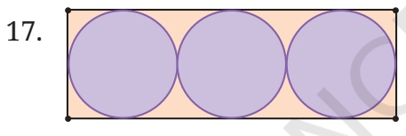
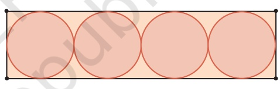
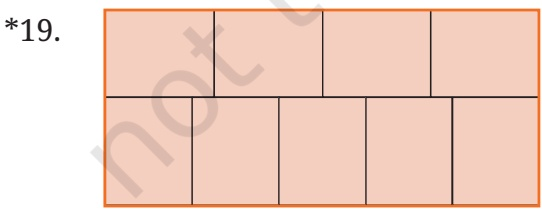

(ii) ∆ABC has sides a, b, c, and ∆PQR has sides 2a, 2b, 2c. Show that ∆PQR has 4 times the area of ∆ABC. Does this mean that 4 copies of ∆ABC will fit into ∆PQR? Check and see!

(iii) ∆ABC has sides a, b, c, and ∆PQR has sides 3a, 3b, 3c. Show that ∆PQR has 9 times the area of ∆ABC. Does this mean that 9 copies of ∆ABC will fit into ∆PQR? Check and see!

\*16.

Fig. 6.43: What fraction of the triangle is shaded?

Fig. 6.44: What fraction of the square is shaded?

Fig. 6.45: What fraction of the rectangle is covered by the circles?

Fig. 6.46: What fraction of the rectangle is covered by the circles?

18. Use the above to make a conjecture about the area occupied by circles fitted into a rectangle in the manner shown. Test your conjecture for particular cases: 10 circles; 20 circles; 50 circles. Then prove your conjecture!

Fig. 6.47: Nine identical rectangles stacked together

The figure shows nine identical rectangles fitted together to make a large rectangle whose area is 72 cm2. Find the perimeter of each small rectangle.