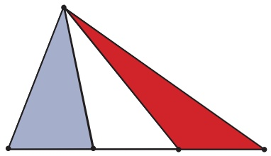
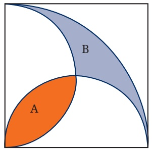
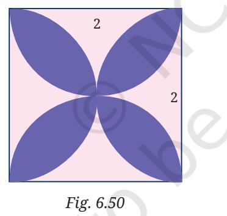
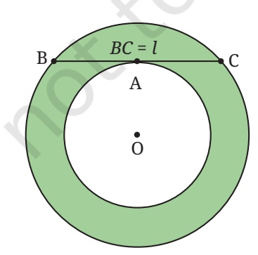

\*21.

\*23.

Fig. 6.48: Lines from a vertex to the points of trisection of the opposite side

Fig. 6.49: A quarter circle and two semicircles

Fig. 6.51

Show that the areas of the shaded blue triangle and the shaded red triangle are equal.

Find a way of cutting up the blue triangle into some number of pieces and rearranging the pieces to cover the red triangle.

The figure shows a quarter circle in a square. Its centre is at one vertex, and it passes through two adjacent vertices. There are two semicircles on two adjacent sides as diameters. They create the shaded regions A and B .

Show that A and B have equal area.

In Fig. 6.50, four semicircles have been drawn within the given square whose side is 2 units. The centres of these semicircles are the midpoints of the sides. They create a 4-petalled flower (shown in blue). Find the perimeter and the area of this flower.

In Fig. 6.51 we see two concentric circles with a common centre O. A chord BC of the larger circle is drawn, touching the smaller circle at A. The length of BC is l. Show that the area of the green region enclosed between the two circles is $\frac { 1 } { 4 }   \pi l ^ { 2 }$