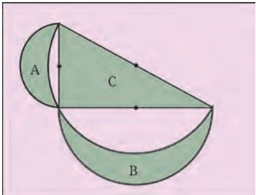
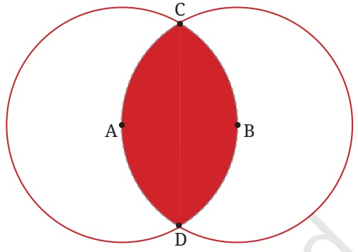
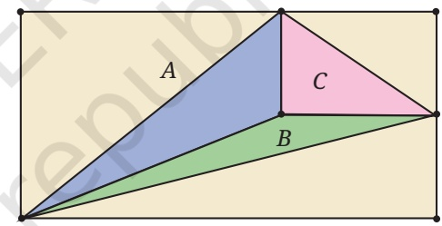
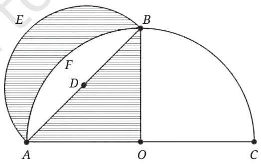

\*24. In Fig. 6.52, semicircles have been drawn on all the sides of a right-angled triangle as shown. Show that Area (A) + Area (B) = Area (C).

Fig. 6.52

Fig. 6.53: Two congruent circles, radius r

\*25. Fig. 6.53 shows two circles passing through each other’s centres. Find the area of the region enclosed by the two circles in terms of the common radius r.

\*26. In Fig. 6.54, we see three triangles within a rectangle. The areas of the triangles are A, B, C, as marked. Show that the area of the rectangle is

$$
\frac{2(A + C)(B + C)}{C}
$$

Fig. 6.54

\*27. In the figure we see two shaded regions formed by a quarter circle, a semicircle, and a triangle.

Fig. 6.55

Show that the areas of the two shaded regions are equal.