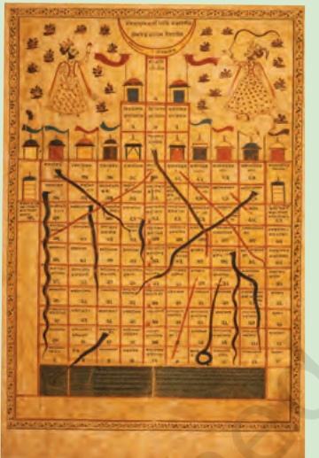

Did you know? The game of Snakes and Ladders originates in ancient India. It evolved from a traditional dice game called **Jñān-Chaupad̤** , which was used as an educational tool. Jñān-Chaupad̤ aimed to convey moral lessons, with each ladder symbolising a virtue and each snake representing a vice. Through gameplay, it illustrated the consequences of good and bad behaviour. Various versions of Jñān-Chaupad̤ have been found in different parts of India.

Fig. 7.4: A Jain Jñān-Chaupad̤ game on cloth, National Museum (India, 19th century)

## 7.2.2 Theoretical Probability

Theoretical probability studies the likelihood of an event happening based on all possible outcomes being **equally likely**. It is what we expect to happen in an ideal, **perfectly fair situation**. In this scenario, no experiment or data is required. Theoretical probability is usually denoted as P (Event) or P (Outcome).

$$
\mathrm{Theoretical probability}(\mathrm{P}) = \frac{\mathrm{number of favorable outcomes}}{\mathrm{ Number of possible outcomes}}
$$

**Example 3:** If you roll a standard 6-sided die, what is the theoretical probability of getting a 4?

**Solution:**

Number of favourable outcomes = 1 (only the number 4)

Number of all possible outcomes = 6 (the numbers 1 through 6)

$$
\mathrm{P}(\mathrm{rolling} \; \mathrm{a} \; 4)=\frac{1}{6}=0.1666 \ldots \approx 0.167 \; \mathrm{or} \; 16.7 \%.
$$

**Example 4:** A letter is picked at random from the word ‘PROBABILITY’. What is the probability of picking the letter B?