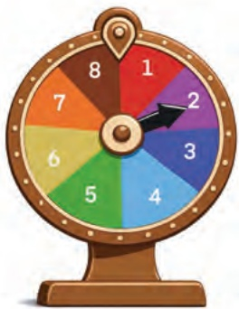

6. A child has 2 shirts (one red and one blue) and 3 types of pants (jeans, khakis, and shorts). List all the possible combinations of outfits consisting of one shirt and one pair of pants. Display your answer in a table format.

7. A tyre company records distances before replacement in 1000 cases.

| Distance | Less than | 4001 to | 9001 to | More than |
| --- | --- | --- | --- | --- |
| (km) | 4000 | 9000 | 14000 | 14000 |
| Number of cases | 20 | 210 | 325 | 445 |

Find the probability that a randomly chosen tyre lasts:

(i) Less than 4000 km.

(ii) Between 4000 and 14000 km.

(iii) More than 14000 km.

8. The letters of the word ‘PEACE’ are placed on cards. Leela draws a card without looking.

(i) What is the probability that it is a P, E or C?

(ii) What is the probability that it is not an E?

\*9. A game of chance consists of spinning an arrow (see Fig. 7.7.) which

comes to rest pointing at one of the numbers 1, 2, 3, 4, 5, 6, 7, 8, and these are equally likely outcomes. What is the probability that it will point at

(i) 8?

(ii) An odd number?

(iii) A number greater than 2?

(iv) A number less than 9?

(v) A multiple of 3?

Fig. 7.7

\*10. A basket contains 4 red balls and 5 blue balls. One ball is drawn and laid aside, and a second ball is drawn. Draw a tree diagram to represent the possible outcomes and probabilities. Use the tree diagram to answer the following questions.