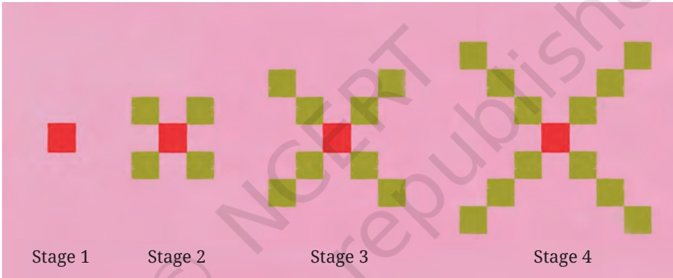

6. Let $T_{1} = 1, T_{2} = 2, T_{3} = 4,$ and $\mathrm{T}_{\mathrm{n}}=\mathrm{T}_{\mathrm{n}-1}+\mathrm{T}_{\mathrm{n}-2}+\mathrm{T}_{\mathrm{n}-3}$ for $n \geq 4 .$ Find $\mathrm{T}_{4}, \mathrm{T}_{5}, \mathrm{T}_{6}, \mathrm{T}_{7}$ and $\mathrm { T } _ { \mathrm { g } }$

## 8.4 Arithmetic Progressions

So far we have learnt that a sequence is an ordered list of numbers that may follow a particular rule. However, there may be sequences, such as the sequence of prime numbers, where there is no clear regularity in the rule.

In this section, we explore a special kind of sequence called an **arithmetic progression**.

The first four stages of the pattern are shown.

Fig. 8.3: Growing pattern of squares

If we count the number of tiny squares at each stage, we get sequence 1, 5, 9, 13.

## Think and Reflect

Can you predict the number of squares in Stages 5 and 6 of the sequence? In Stages 10, 11 and 12? In Stage 20? At any stage?

We observe that at each stage, 4 squares get added to the corners of the pattern in the earlier stage. The number of squares at successive stages can be written as

$$
1,1+4,1+4+4,1+4+4+4,\ldots
$$