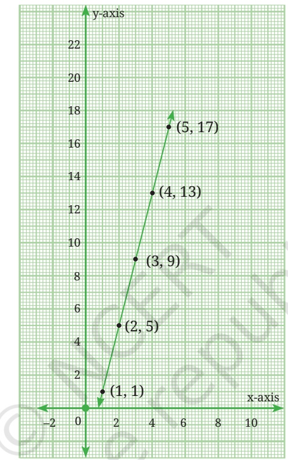

Let us form a pair of numbers $( x , y )$ using the information in the table above where x represents the stage number and y the corresponding number of squares. When we plot the ordered pairs emerging from the table, that is, (1, 1), (2, 5), (3, 9), (4, 13), (5, 17), we observe that they lie on a straight line! This is shown in Fig. 8.4.

Fig. 8.4: Growing pattern of squares represented by a linear pattern

**Exercise:** Verify that the following sequences are arithmetic progressions and write their $n ^ { t h }$ terms. What do you observe when you plot the ordered pairs emerging from them?

(i) 2, 5, 8, 11, … (ii) $- 5 , - 1 , 3 , 7 , \ldots$

**Exercise:** Using the formula $t _ { n } = a + ( n - 1 ) \times d ,$ find the $n ^ { t h }$ term of the following arithmetic progressions.

(i) $\frac{1}{2}, \frac{5}{2}, \frac{9}{2}, \frac{13}{2}, \ldots$ (ii) 1.5, 3.5, 5.5, 7.5, …

Note that $t_{n}=a+(n-1)\times d$ is the explicit rule for finding the $n ^ { t h }$