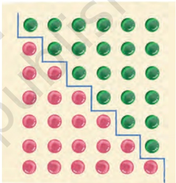

## Think and Reflect

Can the same approach be used to find the sum of $1+2+3+\cdots+100?$

This method of writing the sum from 1 to any number, reversing the sum and then adding the two expressions can be used to arrive at the formula for the sum of the first n natural numbers for any value of n.

Let $S = 1 + 2 + \cdots + n.$

Then $S = n + (n - 1) + \cdots + 1.$

So, $2 \mathbb { S } = n ( n + 1 )$ . We conclude $S = { \frac { n ( n + 1 ) } { 2 } }$

We can also think of this argument pictorially.

The diagram in Fig. 8.5 represents the method to find the sum $1+2+3+4+5+6.$ Note that the figure comprises two sets of circles that represent the sum 1 + 2 + 3 + $4   +   5   +   6$ above and below of the zigzag partition. The total number of circles forms a $7 \times 6$ rectangular array.

$$
2 \times (1 + 2 + 3 + 4 + 5 + 6) = 7 \times 6
$$

Fig. 8.5

Thus, Fig. 8.5 represents the fact $2 \times (1 + 2 + 3 + 4 + 5 + 6) = 7 \times 6.$ This can similarly be extended to find the sum

$$
1+2+3+4+5+6+7+8+9+10.
$$

Namely, $2 \times (1 + 2 + 3 + 4 + 5 + 6 + 7 + 8 + 9 + 10) = 10 \times 11.$

In general, $2 \times (1 + 2 + 3 + 4 + \cdots + n) = n \times (n + 1).$

Therefore, $1 + 2 + 3 + 4 + \cdots + n = \frac{n(n + 1)}{2}$

If we use the notation $\mathsf { S } _ { \mathrm { n } }$ to represent the sum of the first n natural numbers, then $S_{n}=\frac{n(n+1)}{2}$