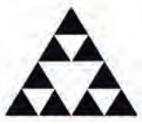
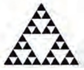
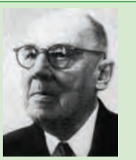

given sequence is a GP with $a = 5$ and $r   =   { \frac { 3 } { 4 } } .$ . The $n^{th}  term  = a \times r^{(n-1)}$ $= 5 \times \left( \frac{3}{4} \right)^{\hat{n-1}}$ . Substitute $n = 1 , 2 , 3 , \ldots$ in this expression to check if you get the terms of the given sequence.

**Exercise:** Check whether the following sequences are geometric progressions and find their $n ^ { t h }$ terms.

(i) 2, 10, 50, 250, …

(ii) $4 , \frac { 8 } { 3 } , \frac { 1 6 } { 9 } , \frac { 3 2 } { 2 7 } , \ldots$

(iii) $3 , \frac { - 3 } { 2 } , \frac { 3 } { 4 } , \frac { - 3 } { 8 } , \ldots$

**Exercise:** Can you find a recursive rule for the formula $t _ { n } = 3 \times 1 0 ^ { n - 1 }$ that generates the geometric progression 3, 30, 300, 3000, … ?

## 8.6.1 Fun with Fractals

Recall from Grade 8 another interesting pattern as shown in Fig. 8.7. Stage 0 represents a piece of paper cut in the shape of an equilateral triangle. Let us join the midpoints of the three sides of the triangle leading to four smaller equilateral triangles. Now remove the central triangle. You will get the figure in Stage 1 with a triangular hole in the centre. Repeat the process on all three black triangles in Stage 1. This will lead to the figure in Stage 2. In a similar manner, we arrive at Stage 3 from Stage 2. The process can be continued forever! This fascinating pattern is known as the **Sierpiński triangle**. This is actually a fractal. We will learn more about fractals in a later grade.

Stage 0

Stage 1

Fig. 8.7

Stage 2

Stage 3

Wacław Sierpiński (1882 – 1969) was a Polish mathematician known for his numerous contributions to mathematics, including the Sierpiński gasket, one of the earliest and most famous examples of a fractal.

