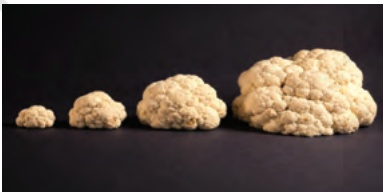
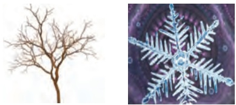

by multiplying the previous term by $\frac { 3 } { 4 }$ . Thus, while the number of black triangles increases rapidly, the total area of the triangles decreases.

Table 1

| Stage (n) | 0 | 1 | 2 | 3 | 4 | 5 | … | n |
| --- | --- | --- | --- | --- | --- | --- | --- | --- |
| N truiamnbgelers o (ftn b)lack | 1 = 30 | 3 = 31 | 9 = 32 | 27 = 33 | 81 = 34 | 243 = 35 | … | 3n |
| Shaded area (sn) | 1 | 34 | 324 | 334 | 344 | 354 | … | 3n4 |

The explicit formula for the number of black triangles and the area of the black region at any stage is given by $t_{n} = 3^{n}$ and $s _ { _ n } = \left( \frac { 3 } { 4 } \right) ^ { n }$ respectively. The recursive rules for the same are

$$
t_{1}=1, t_{n}=3 \times t_{n-1} \text { for } n \geq 2 \text { and } s_{1}=1, s_{n}=\frac{3}{4} \times s_{n-1} \text { for } n \geq 2.
$$

**Fractals** are shapes or patterns that repeat themselves at different scales. This means that if you zoom in on a small part of a fractal, it looks similar to the whole! Fractals are found throughout nature — like in the branching of trees, in vegetables, such as cauliflower or broccoli, in the shape of snowflakes, or in the patterns of coastlines. They can be created using simple rules but can form very complex and beautiful designs. Fractals help us understand patterns in nature, and also lead us to important <u>concepts in mathematics.</u>

Fig. 8.8

## 8.6.2 Visualising a GP

Let us revisit the growing pattern of squares in Fig. 8.6 and prepare a table that shows the number of green squares at each stage.