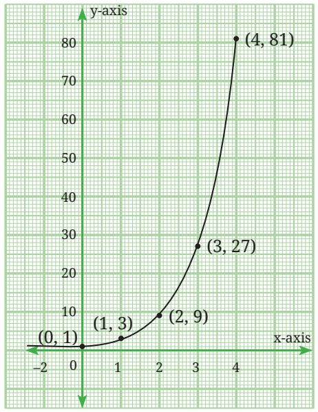
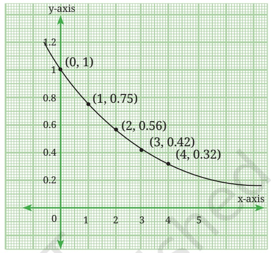

(A)

(B)

Fig. 8.10: Points emerging from a GP arising out of the stages of the Sierpiński Triangle

Here is another example in which a GP arises.

**Example 10:** A ball is dropped from a height of 24 feet above the ground. Each time the ball bounces up to $\left( \frac{3}{4} \right)^{\mathrm{th}}$ of its previous height.

(a) Can you write the sequence of numbers obtained from the heights attained by the ball in five successive bounces? (b) How many bounces are required for the ball to remain below a height $\mathrm { o f } \frac { 1 } { 6 }$ of the original height from which it was dropped? The sequence of maximum heights attained by the ball after each bounce is: First bounce: 24 × 0.75 = 18 feet Second bounce: 18 × 0.75 = 13.5 feet Third bounce: 13.5 × 0.75 = 10.125 feet Fourth bounce: 10.125 × 0.75 = 7.59375 feet Fifth bounce: 7.59375 × 0.75 = 5.695 feet Sixth bounce: 5.695 × 0.75 = 4.27125 feet Seventh bounce: 4.27125 × 0.75 = 3.2034375 feet