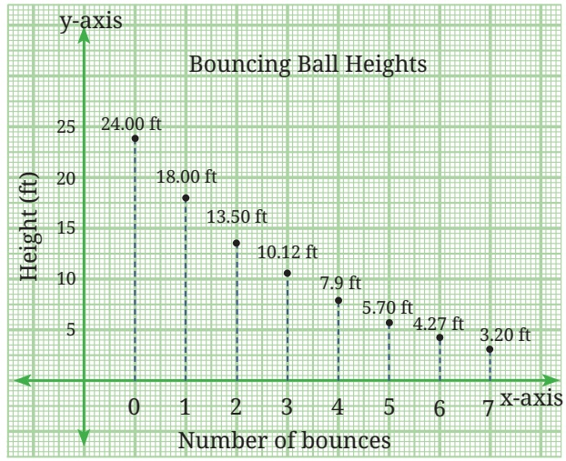

Fig. 8.11

The sequence of heights forms a GP with a = 18 and $r = 0.75$ (or $\frac { 3 } { 4 } )$ , that is, 18, 13.5, 10.125, 7.594, 5.695, 4.27125, 3.2034375, … . We see that after the seventh bounce the ball remains below $\frac{1}{6}$ of the height at which it started.

## Exercise Set 8.3

1. Find the $1 2 ^ { \mathrm { t h } }$ term of a GP with common ratio 2, whose $8 ^ { \mathrm { t h } }$ term is 192.

2. Find the $1 0 ^ { \mathrm { t h } }$ and $n ^ { t h }$ terms of the GP: 5, 25, 125, … .

\*3. A sequence is given by the recursive rule $t_{1} = 2, t_{n + 1} = 3t_{n} - 2$ for $n \geq 1$ . Which term of the sequence is 730?

4. Which term of the GP: 2, 6, 18, … is 4374? Write the explicit formula as well as the recursive formula for the $n ^ { t h }$ term.

5. A ball is dropped from a height of 80 metres. After hitting the ground, it bounces back to 60% of the height from which it fell. It continues bouncing in this way — each time rising to 60% of the previous height.

(i) What height does the ball reach after the $5 ^ { \mathrm { t h } }$ bounce?

(ii) What is the total vertical distance the ball has travelled by the time it hits the ground for the $6 ^ { \mathrm { t h } }$ time?