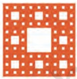

6. Which term of the sequence $2 , 2 \sqrt { 2 } , 4 , \ldots$ is 128?

7. Fig. 8.12 shows Stages 0 to 3 of the Sierpiński square carpet. Stage 0 of this fractal is a square sheet of paper. To construct Stage 1, each side of the square is trisected and the points of trisection of opposite sides are joined to obtain nine smaller squares. The centre square is then removed and the 8 smaller squares are retained, leaving a square hole in the centre. The same process is repeated on the eight smaller shaded squares to obtain Stage 2 and so on.

Stage 0

Stage 1

Stage 2

Stage 3

Fig. 8.12: Stages 0, 1, 2 and 3 of the Sierpiński square carpet

Look at Fig. 8.12 and try to answer the following questions.

(i) How many red squares are there in Stages 0 to 3?

(ii) Can you predict the number of red squares in Stages 4 and 5?

(iii) Can you find a rule for the number of red squares at the $n ^ { t h }$ stage? Write the explicit formula as well as the recursive formula for the number of red squares at any stage.

(iv) Suppose the area of the square in Stage 0 is 1 square unit. What is the area of the red region in Stages 1, 2 and 3? What will be the area of the red region in Stages 4 and 5? Find the explicit as well as the recursive formula for the area of the red region at the $n ^ { t h }$ stage. What happens to this area as n, the number of stages, goes on increasing?

## End-of-Chapter Exercises

1. Find the 31st term of an AP whose $1 1 ^ { \mathrm { t h } }$ term is 38 and $1 6 ^ { \mathrm { t h } }$ term is 73.

2. Determine the AP whose third term is 16 and whose $7 ^ { \mathrm { t h } }$ term exceeds the $5 ^ { \mathrm { t h } }$ term by 12.