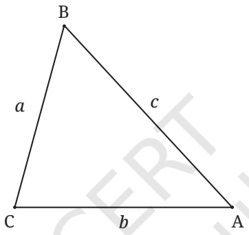
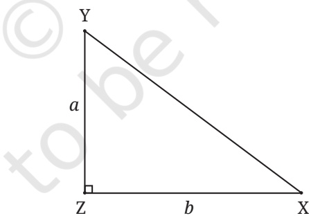

**Example 5:** Here is a statement of the Baudhāyana–Pythagoras theorem.

Let $a , b , c$ be the sidelengths of a triangle. If the triangle is right-angled, then $a ^ { 2 } + b ^ { 2 } = c ^ { 2 }$

What is its converse?

To write the converse, we keep the first sentence of the Baudhāyana– Pythagoras theorem as it is, and make the necessary change in the second.

Let a, b, c be the sidelengths of a triangle. If $a ^ { 2 }   +   b ^ { 2 }   =   c ^ { 2 } ,$ then the triangle is right-angled.

Is this converse true?

Let $\Delta \mathrm { A B C }$ be the triangle with sidelengths a, b, c such that $a^{2} + b^{2} = c^{2}$

Construct another right triangle ∆XYZ whose perpendicular sides YZ and XZ have sidelengths a and b.

What can we say about the length of XY?

(**Hint:** Use the Baudhāyana–Pythagoras Theorem.)

What can we say about ∆ABC and ∆XYZ?

(**Hint:** Use the SSS criterian for congruence.)

We conclude that ∆ABC had to be a right triangle after all.

Hence the converse of the Baudhāyana–Pythagoras Theorem is also true!